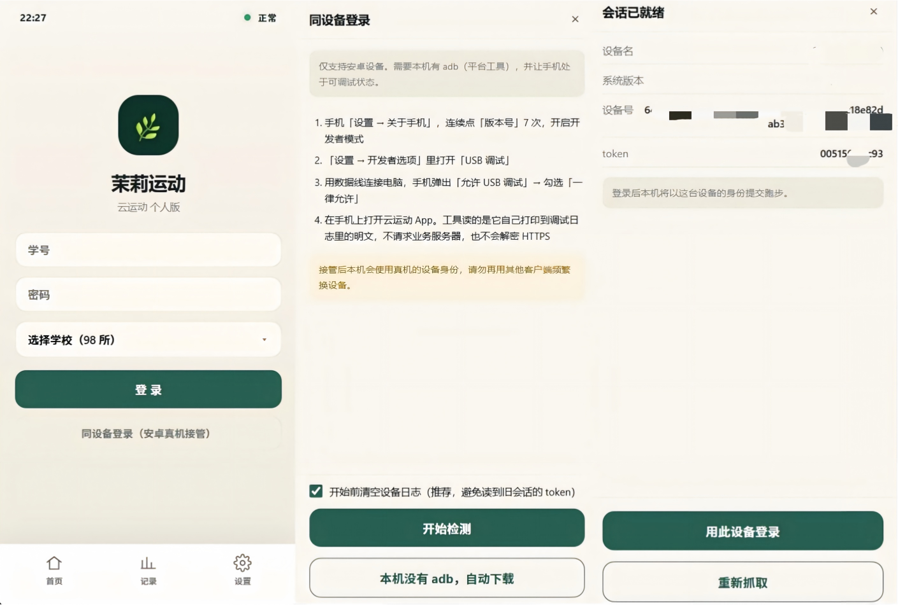
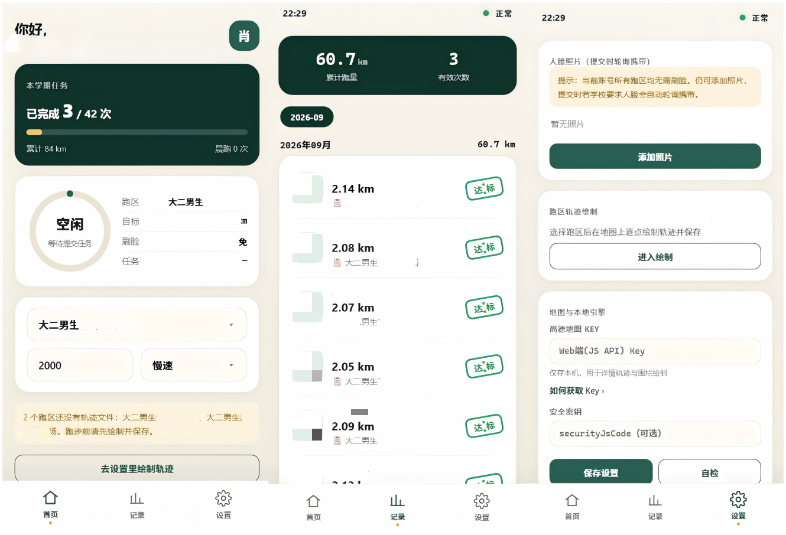

# 茉莉 · 云运动

校园跑步 App「云运动」的第三方桌面客户端，由早前的「蔚园运动」演变而来。

界面基于 PyQt6 自绘，目前仅发布 Windows 端；代码中部分 UI 与工具函数借助 AI 生成，
可能存在冗余，欢迎指出。理论上支持所有使用云运动平台的学校（学校列表取自官方公开接口），
但未在全部学校实测，若你的学校不可用，欢迎提 Issue。

## 界面预览

软件 UI 界面效果如下：

<p align="center">
  
  
</p>

## 下载安装（普通用户）

1. 到 [Releases](https://github.com/GoldenJinDev/moli-cloud-sports/releases) 下载发行包 `moli-v1.0.zip`
2. 解压到任意文件夹（会生成一个 `moli` 目录和同级的 `一键运行.bat`）
3. 双击 `一键运行.bat` —— 首次运行会自动准备运行环境（约需几分钟），完成后自动启动客户端；
   之后再双击就是直接进客户端，不再重复配置环境
4. 首次启动可能被 Windows SmartScreen 拦截 → 点「仍要运行」
   （程序未签名，属正常现象；如不放心可自行从源码构建）

> 不需要先装 Python：本机没有可用的 Python 时，脚本会下载官方 3.11 并只装进包内目录，
> 不写 PATH、不影响系统里已有的 Python。
> 账号、轨迹、照片等数据仅保存在本机，删掉 `data` 文件夹即可清空。

旧的 Windows 安装包暂时不走这条渠道，改用上方的发行包：

~~1. 到 [Releases](https://github.com/GoldenJinDev/moli-cloud-sports/releases) 下载 `moli-win-Setup-v1.0.exe`~~
~~2. 双击安装，可选择安装位置，勾选「创建桌面快捷方式」~~
~~3. 首次启动会被 Windows SmartScreen 拦截 → 点「仍要运行」~~
~~（程序未签名，属正常现象；如不放心可自行从源码构建）~~
~~安装包含独立运行环境，无需安装 Python。~~
~~账号、轨迹、照片等数据仅保存在本机。~~

## 从源码运行

从仓库拉源码的（源码直接在仓库根目录），把 `一键运行.bat` 放到源码同级目录后双击，效果同上；
脚本认这两种布局：与源码同级、或在源码目录（如 `moli/`）的上一级。

```bash
一键运行.bat            # 准备环境并启动
一键运行.bat deps       # 强制重装依赖
一键运行.bat nogui      # 只准备环境，不启动
```

环境自己搭（或只想改协议不想装界面依赖）：

```bash
python -m pip install -r requirements.txt   # 界面
python -m pip install requests gmssl pydantic geographiclib   # 只做命令行/协议开发
python moli.py
```

需要 Python 3.10+、Windows。Anaconda/Miniconda 的 Python 建出的虚拟环境里
PyQt6 会加载失败，请用 python.org 的版本。

不想开界面也可以直接用命令行：

```bash
python cli.py login --user <学号>
python cli.py run --distance 1200 --fast
```

## 二次开发（Python）

想接自己的界面、定时任务或数据分析，用 `sdk.py`，**不需要装 PyQt6**：

```bash
python -m pip install requests gmssl pydantic geographiclib
```

```python
import asyncio, sdk

async def main():
    client = await sdk.login(user="<学号>", password="<密码>", school_code="106")
    client.save_session()                     # 与 cli.py 共用 data/cli_session.json
    print(client.run_areas)                   # 跑区名称

    await client.run(distance=1200, fast=True)   # 快速：同步跑完
    task = await client.run(distance=1200)      # 慢速：先拿 task_id
    print(await client.wait(task["task_id"]))   # 再等它跑完

    print(await client.records())             # 本学期运动记录
    print(await client.sport_info())          # 达标概况
    await sdk.close()

asyncio.run(main())
```

已有登录态时直接接管，不必再输密码：

```python
client = sdk.Client.from_session_file()       # 读 data/cli_session.json
```

三点须知：

1. **入口只有 `sdk.py`。** 它薄封装业务层 `services.py`；`api.py` 里的会话是当前进程的
   全局单例，为 GUI 单账号设计，请不要引用，多账号会互相覆盖。
2. **慢速模式必须保持进程存活。** 任务状态存在进程内存里，进程一退任务即丢。
   一次性脚本或短生命周期进程请用 `fast=True`，或把 `run` 与 `wait` 放在同一事件循环内。
3. **错误只有一种。** 业务失败统一抛 `sdk.AppError`（`.detail` 是中文原因）；
   网络层异常仍按 `requests` 原样抛出，需要自己兜。

参数与返回值的完整形状看 `sdk.py` 顶部文档串和各函数 docstring，字段以代码为准。
只想改协议或改轨迹算法的话，`upstream.py`（接口与加解密）和 `track_gen.py`（轨迹生成）
都可以脱离界面单独调通。

## 功能

- 📱 桌面端手机界面（PyQt6），登录信息本机保存、重开自动登录
- 🔐 账号、轨迹、照片等数据仅存本机，不上传第三方服务器
- 🏃 跑步任务提交：慢速（后台执行 + 进度轮询）/ 快速（同步完成）
- 📊 运动记录：按月分组、达标印章，点击查看速度着色轨迹详情（高德地图）
- ✏️ 跑区轨迹绘制：地图逐点绘制 → 闭合/里程校验 → 保存本机
- 😀 人脸照片管理：多张添加、每个抽查点各随机取一张比对；入库前做格式/比例/大小质检
- 📲 同设备登录：用数据线接管自己安卓真机的会话，本机直接沿用真机的设备身份
- 🗺️ 地图需自备高德 Web端(JS API) Key，在应用内「设置」填写

## 常见问题

**Q：为什么需要自己申请高德 Key？**
A：地图轨迹展示依赖高德 JS API，Key 与账号绑定，无法内置分发。

**Q：我的学校登录失败怎么办？**
A：先确认学校在官方接口列表中；若仍失败，请提 Issue 并附上学校名称。

**Q：会被学校检测到吗？**
A：本项目不讨论、也不保证任何规避检测的能力，请自行评估使用风险。

## 更新记录

### 2026-11-13

**1. 上报版本抬到 3.6.7**

平台从 2026-10-20 起对部分学校强制最低 App 版本，发 3.6.6 的请求会被直接拒掉（表现为能登录，但跑区和记录一片空白）。客户端上报版本改为 3.6.7。若你的学校仍取不到跑区，提示里会带上平台返回的真实原因，不再只有一句"解析失败"。

**2. 刷脸抽查贴着里程点发生**

平台会下发一个或多个抽查里程点。此前要等这一批定位点全部上报完才发起比对，最晚会比实际位置晚几百米；现在是在这一批点里定位到越过抽查点的那一刻，先把该点之前的定位补发出去再比对，并按平台下发的识别时长在比对前停留几秒。慢速模式总时长不变，不需要刷脸的跑区行为完全没变。

**3. 每个抽查点换一张照片**

照片不再在提交前固定成一张：本机「设置」里的照片构成一个池，录入用一张，之后每个抽查点各随机取一张（同一处抽查的补发沿用同一张）。更接近真机上每次刷脸都是不同帧。命令行 `--face auto` 与此一致；`--face 某.jpg` 仍是全程用那一张。

**4. 成绩不合格不再显示"完成"**

平台判定不合格、或返回内容认不出来时，界面和日志都会明确写"不合格"及原因，不会再把失败当成功。

**5. 登录页可自选设备**

学号/密码/学校下面多了一行设备选择：默认「随机设备」，也可以从内置机型里挑一台，或选「自定义…」手填（形如 `vivo(V2366GA)`）。选完直接登录就按这台设备提交，不需要再进设置。列表由程序内置机型给出，本机保存、重开仍在；「同设备登录（真机接管）」会把设备名换成手机读到的那一个。

**6. 人脸照片入库质检，压缩参数对齐真机**

「设置 → 人脸照片」添加照片时先过一道本地质检（`face_check.py`，纯标准库、不额外装任何东西）：必须是 JPEG、能读出尺寸、竖版 3:4、不小于 50KB；超过 150KB 只提醒不拦。上传时前端也改成按真机的处理链走：中心裁 3:4、长边 720、质量压到 100~150KB（原来是 512px/0.85 且不裁比例）。因为抽查照片现在是逐点随机抽，池子里混进糊图或比例不对的图会直接影响成绩，所以把闸门放在入库这一步。

> 说明：官方 App 的录入链是 `Luban(100KB) → MyUCrop 3:4`，比对链是 `720px + 150KB`。本项只对齐了格式与规格，**没有引入人脸模型**（置信度、左右偏转/俯仰/翻滚那层需要 onnxruntime 与模型文件，按决定不装）。

**7. 上报版本号可以在设置里改了**

「设置 → 上报版本号」可临时改客户端上报的 version（形如 `3.6.8`），保存后**下一次请求即生效，不用重启**；本机记住这个值，重开自动恢复；点「恢复默认」回到代码里的内置版本。平台以后再次抬高版本门槛时，不用等本项目发新版：登录正常却取不到跑区/记录，把平台要求的版本号填进去即可。填得不像版本号会被拒绝，与内置版本不同大版本时会提示一句协议可能一起变了。

**8. 学校接口地址自动跟上**

学校列表改为「用时刷新」：启动、点开学校下拉、以及按学校编码解析不到时各刷一次（15 秒内不重复打上游）。上游偶发返回空列表时**保留旧列表**，不会把上百所学校刷成只剩内置那一所。设置页会显示列表数量、上次刷新时间与最近一次变更。

若刷新发现**当前学校的接口地址变了**：本机存了账号密码的，自动重新登录并刷新跑区；用「同设备登录」接管、本机没存密码的，会把你带回登录页提示重新登录（接管会话不保存密码，无法代你重登）。

**9. 刷脸跑的上报形态补齐**

结束上报的那一包里，此前缺了官方客户端从 3.6.7 起**无条件附带**的一段设备检测信息（干净机形态：各项均为"未检测到风险"、模拟器名为空串）。现已按官方形态补齐，并与同类开源实现逐字段核过（上报字段集完全一致）。

> 这条与「两次人脸比对都返回通过、成绩却仍被判认证次数不足」的现象相关，**尚需现网验证**；如果你遇到过这种判定，欢迎在 Issue 里附上 `logs/app.log` 中 `[yun_run]` 那几行。

### 2026-09-24

**1. cli 登录支持接管已有会话**

正常登录不变（`python cli.py login --user <学号>`）。新增三个参数，可跳过登录、
直接复用一份已有会话（例如你自己手机上产生的 token）：

```bash
python cli.py login --user <学号> --token <token> --uuid <64位设备号> --device-name "vivo(V2366GA)"
```

也可只在普通登录时指定设备身份：`--uuid` / `--device-name` 单独使用即可。

**2. 新增真机调试助手 `devinfo.py`（可选，面向开发者）**

独立脚本，不依赖本项目其他代码，通过 adb 连接自己的手机（真机 USB/无线均可，
模拟器+虚拟定位环境同样适用）。

> 注意：它**不是抓包，也没有解密 HTTPS**——读取的是云运动 App 自行打印到
> Android 调试日志(logcat)里的明文（加密前的请求、解密后的响应）。
> 官方一旦在发布版关闭日志打印，此功能即失效，届时欢迎提 Issue 讨论替代方案。

功能：

- 读取手机的 deviceName / sysEdition / deviceId（含具体读取失败原因）
- 从调试日志提取登录 token（显示日志时间戳，旧会话会提示）
- 实时查看请求/响应明文，**原始日志自动存档**到 `devinfo_logs/<时间戳>/`
- 一键**脱敏打包**：抹除密码/token/姓名/学号/人脸base64/设备号后生成 zip，
  可直接发给他人或 AI 分析

使用前需开启手机 USB 调试：

1. 设置 → 关于手机 → 连续点击「版本号」7 次，开启开发者模式
2. 设置 → 开发者选项 → 打开「USB 调试」
3. 数据线连电脑，手机弹窗「允许 USB 调试」→ 勾选一律允许
4. 电脑装 adb（没有也没关系，脚本会引导自动下载 Google 官方 platform-tools）

运行：

```bash
python devinfo.py
# [1] 提取登录 token
# [2] 查看调试日志（实时滚动 + 原始行存档）
# [3] 将已存档日志脱敏打包 zip
```

> 提示：日志包含账号等敏感信息，分享前务必走 [3] 脱敏；调试完可执行
> `adb logcat -c` 清除设备日志缓冲。

**3. 新增二次开发入口 `sdk.py`**

不用开界面、不用装 PyQt6 就能调全部业务接口，详见上文「二次开发（Python）」。

**4. 登录页新增「同设备登录」（安卓真机接管）**

入口在登录按钮下方。点开向导，按提示开启 USB 调试并用数据线连接手机，程序会依次
检查 adb → 确认设备 → 读取 deviceId 与设备名 → 从调试日志里取出登录 token
（最后一步需要你在手机上打开云运动，最长等 3 分钟，可随时取消）。
取到后即可用这台设备的身份直接登录，不必输密码；本机之后的普通登录也会沿用该设备身份。

> 与 `devinfo.py` 同一原理：读的是 App 自行打印到 Android 调试日志里的明文，
> **不抓包、不解密 HTTPS**，因此仅支持安卓，且官方一旦在发布版关闭日志打印即失效。
> token 属敏感信息，界面只显示首尾几位；「开始前清空设备日志」勾选后会执行 `adb logcat -c`。

**5. 新增 `一键运行.bat`**

双击即可：自动建虚拟环境（`.venv/`）、换国内源装依赖、启动客户端；本机没有 Python
会先下载官方 3.11 装进同目录的 `python-3.11.9`（不写 PATH、不注册启动器）。
环境已经就绪时直接启动，不重复配置。详见「从源码运行」。

**6. 界面补齐三处细节**

- 登录后首页会检查各跑区在本机有没有轨迹文件，缺的直接列出来并给入口去绘制（只提示不拦截）
- 高德 Key 输入框下加「如何获取 Key」，展开分步教程的同时自动打开高德控制台
  （教程里提醒了关键一点：域名白名单留空，本机是 `file://` 打开的，填了会报 `INVALID_USER_DOMAIN`）
- 设置页底部加「关于」卡：版本号、可点的仓库地址、复制地址、提 Issue

## 目录结构
```
一键运行.bat       准备环境并启动（可与源码同级，也可放在源码目录的上一级）
moli.py            入口（GUI）
cli.py             命令行入口（无 GUI，直接调用业务层）
sdk.py             二次开发入口（Python 调模块，不依赖 PyQt6）
devinfo.py         真机调试助手（可选，需 adb，与客户端本体无关）
takeover.py        同设备登录：adb 读真机设备身份与 token（界面调用）
bridge.py          JS ↔ Python 调用层
face_check.py      人脸照片入库质检（纯标准库：JPEG 格式 / 尺寸 / 3:4 / 大小）
api.py             会话、轨迹校验与本机轨迹文件查询
services.py        业务服务层
upstream.py        上游协议 / SM2 / SM4 加密
track_gen.py       轨迹生成
static/index.html  UI 页面（QWebEngineView 承载，bridge.py 负责 JS ↔ Python 通信）
```

> 本机数据全在 `data/`（登录态、人脸照片、轨迹），日志在 `logs/`，
> 调试存档在 `devinfo_logs/`，脚本生成的环境在 `.venv/`、`python-3.11.9/`、`.tmp/` ——
> 以上均已 gitignore。删掉 `data/` 即可彻底清干净本机痕迹。

## 项目状态

逆向自 APK 公开网络协议，仍在持续优化中：

- [x] Nuitka 打包 + Inno Setup 安装包（暂不作为主要分发方式，主要发发行包 + 一键运行脚本）
- [x] 上游接口经真机反编译逐端点核对
- [x] 刷脸跑步实测（2026-10-10 现网通过：跑中抽查比对、成绩判定；人脸录入与审核分支因测试账号早已录入，尚未覆盖）
- [ ] 每个抽查点随机换一张照片（离线链路已验通，现网未实测）
- [ ] 轨迹生成算法拟真度调优
- [ ] 更多学校实测
- [ ] 清理 AI 辅助生成代码中的冗余（欢迎 PR）

欢迎 PR 与 Issue。

## 相关项目

- [Zirconium233/yunForNewVersion](https://github.com/Zirconium233/yunForNewVersion) —— 同类开源项目，思路相近、实现不同，推荐一看。

## 免责声明

本项目**仅供学习交流与技术研究**。逆向内容基于公开网络协议，
相关接口、数据与服务归平台及学校所有。请勿用于任何商业用途、
代跑作弊或其他违反校规校纪与法律法规的行为，由此产生的后果与作者无关。
使用即代表你已阅读并同意以上条款。
